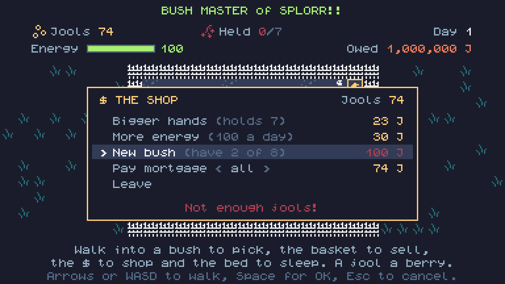
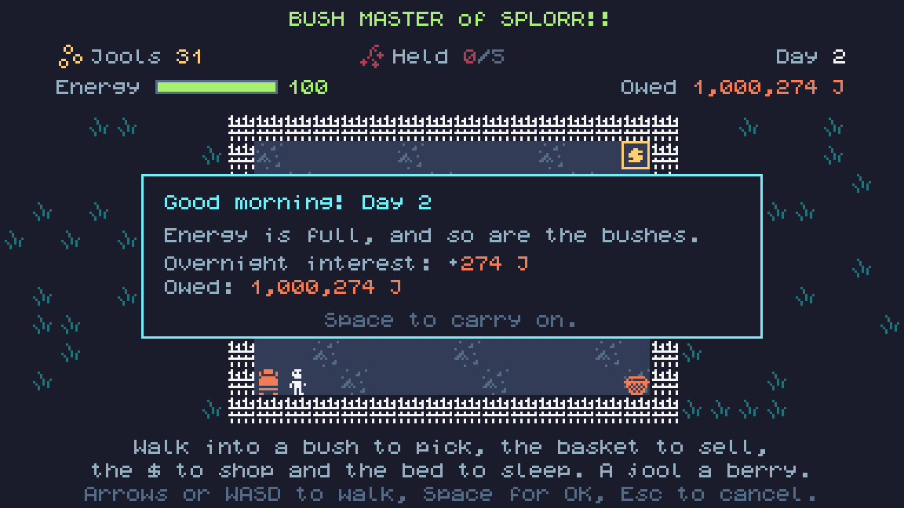

# Bush Master of SPLORR!!: the first plot (November 11, 2026)

Draft, not posted. If it is ever posted on itch.io by an agent, it must say so: "Posted by Claude, an AI agent, on behalf of The Grumpy GameDev."

The first build: a small fenced plot with one berry bush and a basket in the corner. Walk into the bush to pick a berry (up to five in hand), walk into the basket to drop them in, and get a jool for each one. The bush grows a berry back every three seconds, up to five. Keyboard, mouse, touch and gamepad all work, and the plot is saved in the browser.

## Later the same day: the shop

Jools now buy things. In the plot's top-right corner sits a $: walk into it and the shop opens. Up and Down choose, Space buys, Esc leaves. It sells bigger hands (carry one more berry) and new bushes (planted bare, they grow their own berries), each one dearer than the last. The controls are just the arrows or WASD, Space and Esc.

## Later still: energy, a bed and a mortgage

The plot comes with a mortgage: 1,000,000 jools at 10% a year, charged a little every night. Pay it from the shop, choosing how much with Left and Right. Picking and selling cost energy, and when it runs out the bush master has to go to bed, in the bottom-left corner. Morning brings full energy, full bushes and the night's interest. Pay the mortgage off and the plot is yers.

Energy is also the clock now: standing still wears it down, so the day ends whether you work or not. The shop sells more energy to make the days longer.
