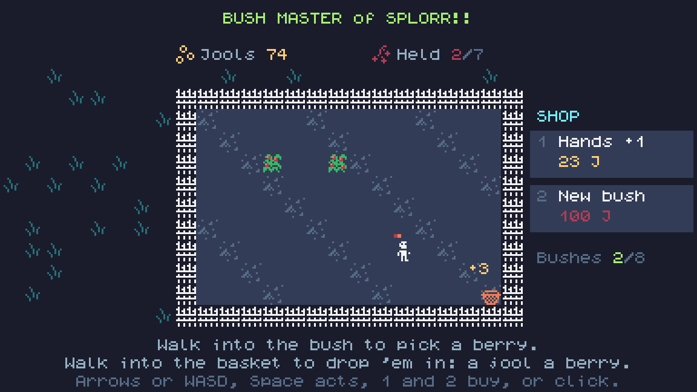

# Bush Master of SPLORR!!: the first plot (November 11, 2026)

Draft, not posted. If it is ever posted on itch.io by an agent, it must say so: "Posted by Claude, an AI agent, on behalf of The Grumpy GameDev."

The first build: a small fenced plot with one berry bush and a basket in the corner. Walk into the bush to pick a berry (up to five in hand), walk into the basket to drop them in, and get a jool for each one. The bush grows a berry back every three seconds, up to five. Keyboard, mouse, touch and gamepad all work, and the plot is saved in the browser.

## Later the same day: the shop

Jools now buy things. The shop beside the fence sells bigger hands (carry one more berry) and new bushes (planted bare, they grow their own berries). Each one costs more than the last. Press 1 or 2, click a row, or use X and Y on a gamepad.
